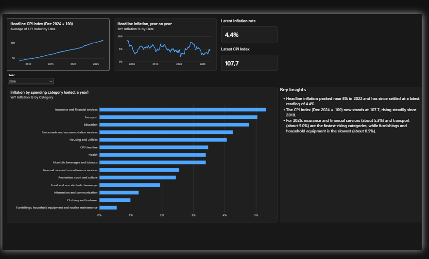
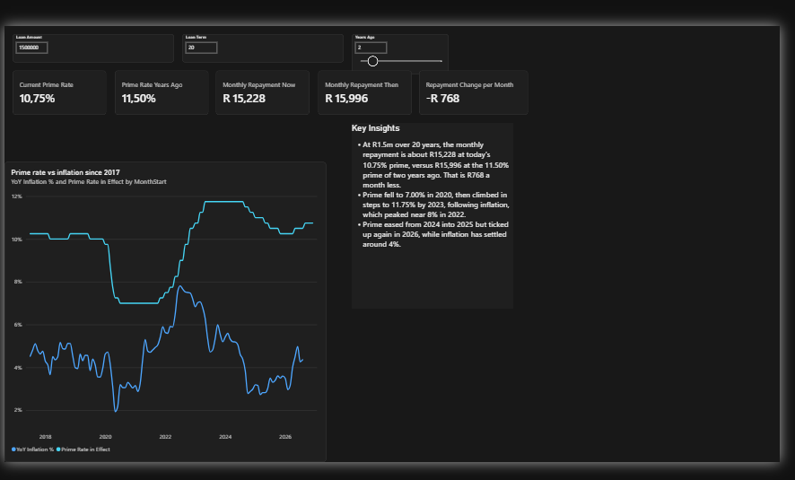

# SA Cost of Living and Interest Rate Tracker

A two-page Power BI dashboard showing how inflation, spending categories and the prime lending rate have moved in South Africa, and what that means for a household with a bond.

**Question it answers:** How have prices and interest rates moved over the last 15 years, and what does that mean for the monthly repayment on a home loan?

Built by Nelson Bhekiswayo. Data to August 2026.

## Dashboard

### Page 1: Cost of living



Headline CPI trend, year-on-year inflation, the latest readings, and inflation by spending category for any year (use the Year slicer).

### Page 2: Household impact



A bond repayment calculator driven by three sliders (loan amount, term, and how many years ago to compare with), plus a chart of the prime rate against inflation since 2017.

## Key findings

- Headline inflation was close to 8% in 2009 and again in 2022. The latest reading (August 2026) is 4.4%.
- The headline CPI index (December 2024 = 100) stands at 107.7.
- So far in 2026 (January to August), insurance and financial services (about 5.3%) and transport (about 5.0%) are the fastest-rising categories. Furnishings, household equipment and routine maintenance is the slowest (about 0.5%).
- On a R1.5m bond over 20 years, the monthly repayment is about R15,228 at today's 10.75% prime, versus about R15,996 at the 11.50% prime of two years ago. That is R768 a month less.
- Prime fell to 7.00% in 2020, rose in steps to 11.75% by 2023 as inflation climbed towards 8%, eased to 10.25% by late 2025, and has edged up again in 2026.

## Data

| Dataset | Source | Coverage |
|---|---|---|
| Consumer Price Index (P0141), COICOP series, urban areas | Stats SA | Monthly, January 2008 to August 2026 |
| Prime lending rate changes | Compiled from published rate histories | July 2017 to September 2026 |

Raw files are in `data/raw`.

## Method

- **Power Query:** filtered the Stats SA file from 789 series to the headline CPI plus 13 main spending categories for urban areas, unpivoted about 224 month columns into rows, and converted month codes such as `MO082026` into real dates.
- **Data model:** a dedicated date table (`DateTable`) marked as a date table and related to the CPI table. Time calculations rely on it.
- **DAX:** year-on-year inflation, latest-value cards, prime rate in effect on any date, and the repayment calculation. All measures are in [dax_measures.md](dax_measures.md).
- **What-if parameters:** loan amount, loan term and years ago, built with Power BI numeric range parameters.

## Limitations

- Prime rate data starts in July 2017, so the rates chart covers 2017 onwards, while CPI goes back to 2008.
- The prime rate table was compiled from published histories. The rows for May 2026 and September 2026 came from news reports. Verify against the South African Reserve Bank before relying on them.
- The repayment calculator assumes the bond rate equals prime, a fixed term, and no fees or insurance.
- "Years ago" counts back from today's date, so the Household impact figures change over time. The figures in this README are as at the date of the screenshots, 30 October 2026.
- The three rand cards (Monthly Repayment Now, Monthly Repayment Then and Repayment Change per Month) are wrapped in `FORMAT()` so they show full rand values instead of "K". This makes them text, so they are for display only. Any further calculation or chart should use the underlying `PMT` formulas.
- Insurance and financial services has only 21 monthly values, so it does not appear for years before 2025/26 and has no earlier history.
- Category figures on page 1 are annual averages of year-on-year changes. 2026 covers January to August only.

## Repository contents

```
sa-cost-of-living-tracker/
├── README.md
├── dashboard.pbix
├── dax_measures.md
├── data/
│   ├── raw/        (Stats SA CPI workbook, prime rate CSV)
│   └── cleaned/
└── docs/           (screenshots)
```

## How to open

Open `dashboard.pbix` in Power BI Desktop (Windows). The data was loaded from local file paths, so refreshing on another machine means updating the file locations under Transform data, then Data source settings. The report itself opens and works without refreshing.
